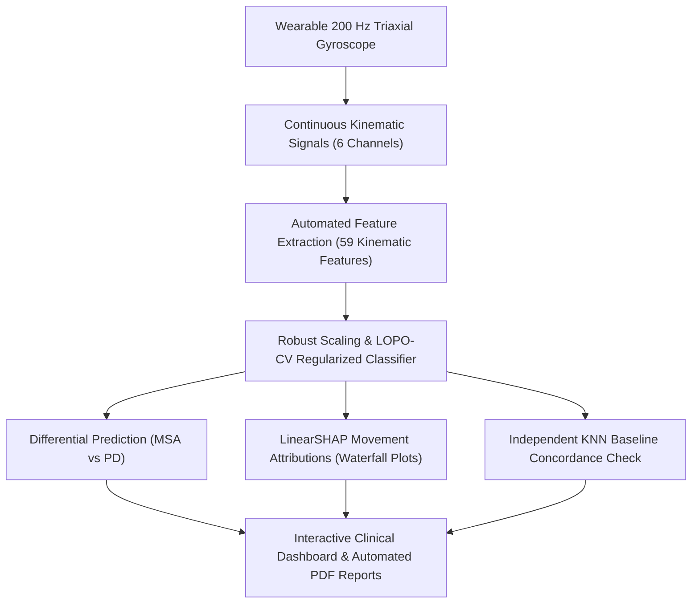

# NeuroScope: Explainable Movement Disorders Research Platform (v3.0)

[](https://python.org)
[](https://fastapi.tiangolo.com)
[](https://react.dev)
[](https://www.typescriptlang.org)
[](https://tailwindcss.com)
[](https://github.com/shap/shap)
[](LICENSE)

An end-to-end clinical research platform for the **differential screening of Multiple System Atrophy (MSA) and Parkinson's Disease (PD)** using continuous $200\text{ Hz}$ 6-channel wearable triaxial gyroscope telemetry from rapid finger-tapping motor trials.

---

## 🌟 Key Highlights

* **59 Engineered Kinematic Features:** Extracts deep time-domain (amplitude decay/fatigue ratio, cadence, rhythm irregularity), frequency-domain (spectral entropy, 4–8 Hz tremor band power), and signal complexity metrics (Hjorth parameters).
* **High-Accuracy Classification:** Regularized Logistic Regression (v3) achieving **92.58% Balanced Accuracy** and **0.912 ROC-AUC** under strict **Leave-One-Patient-Out Cross-Validation (LOPO-CV)**, eliminating patient-level data leakage.
* **Native LinearSHAP Explainability:** Replaces opaque black-box outputs with exact, closed-form Shapley values ($\phi_i = w_i \cdot x_{\text{scaled}, i}$), visualizing which biomechanical features push the differential odds toward MSA or PD.
* **Clinical Uncertainty Protocol:** Real-time flagging for borderline decision boundary probabilities (45%–55%), short recording duration ($<4\text{ s}$), and model consensus discordance against an Independent KNN Baseline.
* **Full-Stack Research Architecture:** High-throughput FastAPI asynchronous backend, SQLite clinical audit registry, automated PDF diagnostic report generation, and an ultra-modern React + TypeScript dashboard.

---

## 🚀 Quick Start (Running Locally)

### Option 1: One-Click Launchers (Windows)

1. **Install Dependencies:** Double-click **`install.bat`** (installs both Python requirements and frontend npm packages automatically).
2. **Start Application:** Double-click **`start.bat`** (launches backend on port 8000, frontend on port 5173, and opens your browser at `http://localhost:5173`).

---

### Option 2: Manual Terminal Commands

#### 1. Backend Setup:
```bash
pip install -r requirements.txt
python -m uvicorn backend.app.main:app --port 8000 --reload
```
*Backend API Docs will be live at: `http://localhost:8000/docs`*

#### 2. Frontend Setup:
```bash
cd frontend
npm install
npm run dev
```
*Frontend Application will be live at: `http://localhost:5173`*

---

## 📊 LOPO-CV Model Benchmark

Evaluated across 27 patient folds (isolated clinical holdouts):

| Model Architecture | Features | Balanced Acc | MSA Sensitivity | PD Specificity | Overall Acc | ROC-AUC |
| :--- | :---: | :---: | :---: | :---: | :---: | :---: |
| **Optimized Logistic Regression (v3)** | **59** | **92.58%** | **92.31% (12/13)** | **92.86% (13/14)** | **92.59% (25/27)** | **0.912** |
| Published Research Baseline (Heliyon 2023) | 6 | 89.29% | 100.00% (13/13) | 78.57% (11/14) | 88.89% (24/27) | 0.909 |
| Baseline Random Forest | 45 | 70.05% | 69.23% (9/13) | 71.43% (10/14) | 70.37% (19/27) | 0.758 |
| Baseline KNN ($k=5$) | 45 | 63.19% | 76.92% (10/13) | 50.00% (7/14) | 62.96% (17/27) | 0.720 |

---

## 🔬 Scientific & Clinical Workflow



---

## 🛡️ Clinical Research Disclaimer

NeuroScope is designed strictly as an academic research platform and clinical decision-support prototype. It is not an FDA/CE-certified diagnostic device and must not replace professional clinical evaluation by a certified neurologist.
